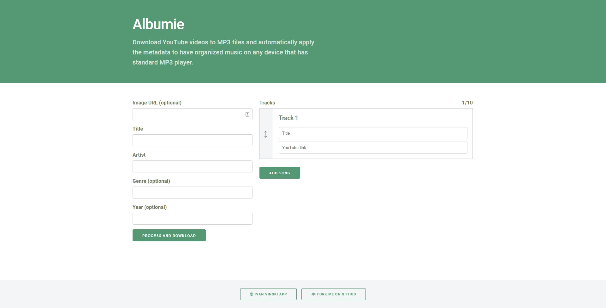

# Albumie
> Convert YouTube to MP3 with metadata for standard MP3 players.

Albumie addresses the problem most YouTube to MP3 converters face and that's not providing options to automatically edit metadata. Even better, Albumie allows you to fill in metadata for multiple tracks.

[Try out Albumie!](https://albumie.com)

## Release History

* 1.0.0
    * Initial version

## Meta

[Ivan Vinski](https://ivanvinski.com) – contact@ivanvinski.com

Distributed under the GPL-2.0 license. See [LICENSE](LICENSE) for more information.

[https://github.com/ivanvinski/albumie](https://github.com/ivanvinski/albumie)

## Contributing

1. Fork it (<https://github.com/ivanvinski/albumie/fork>)
2. Create your feature branch (`git checkout -b feature/fooBar`)
3. Commit your changes (`git commit -am 'Add some fooBar'`)
4. Push to the branch (`git push origin feature/fooBar`)
5. Create a new Pull Request
