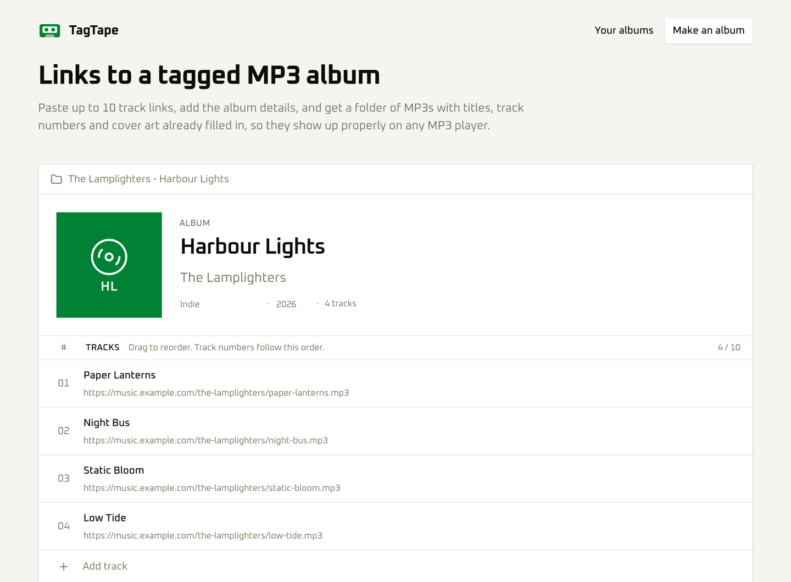

# TagTape
> Turn track links into a tagged MP3 album for standard MP3 players.

[](https://github.com/vindotski/tagtape/actions/workflows/ci.yml)



Paste up to 10 track links (one track each, up to 2 hours long), add the album title, artist, year, genre and a cover image, and download a ZIP of MP3s with every tag filled in and the tracks numbered in your order. The albums show up properly on any plain MP3 player.

**Nothing is stored on the server:** tracks convert while the ZIP streams to your browser.

Out of the box, TagTape reads **direct links to MP3 files**. Other kinds of links can be added with [source plugins](#sources-and-plugins).

Built with [TanStack Start](https://tanstack.com/start), with a Fastify service running ffmpeg. Version 1 was a 2020 Symfony/PHP app called Albumie; its code is preserved at the [`v1.0.0`](https://github.com/vindotski/tagtape/tree/v1.0.0) tag.

[tagtape.app](https://tagtape.app)

## Run it

**Hosting it for real?** See [docs/deploy.md](docs/deploy.md): one Linux server on any cloud-init provider (DigitalOcean, Hetzner, Vultr, Linode, AWS, …), Caddy for HTTPS, and one-click deploys from GitHub Actions.

The web app and the API ship together as **one image, with one version**:

```bash
docker run --rm -p 3000:3000 vindotski/tagtape
# → http://localhost:3000
```

There's nothing to configure. Inside the container, [`docker/start.mjs`](docker/start.mjs) starts the API on `127.0.0.1:4000` (not exposed) and the web app on `:3000`, with a fresh internal token each time. If either process dies, the container stops, so your orchestrator restarts both together. The image is published for linux/amd64 and linux/arm64, with provenance and an SBOM attached.

| Tag | Published from |
|---|---|
| `latest` | every push to `main` |
| `2.0.0`, `2.0`, `2` | the git tag `v2.0.0` |
| `sha-abc1234` | every publish (immutable; use it to pin a deployment) |

The running version shows in the web app's footer, and the internal API reports it on `/health`. Builds from `main` carry build metadata, e.g. `2.0.0+main.abc1234`. To build the image yourself, run `docker build -t tagtape .`

### Releasing

The web app and the API share **one version**, which lives in the root `package.json`. See [CHANGELOG.md](CHANGELOG.md).

1. Bump `"version"` in the root `package.json` and add a `CHANGELOG.md` entry, then commit.
2. Once that commit is on `main`, run `git tag vX.Y.Z && git push origin vX.Y.Z`. CI refuses a tag that doesn't match `package.json`, and then publishes `X.Y.Z`, `X.Y`, `X` and `latest`.

| Variable | Default | |
|---|---|---|
| `PORT` | `3000` | Public port of the web app. |
| `JOB_TTL_MIN`, `MAX_ACTIVE_STREAMS`, `MAX_QUEUED_STREAMS`, `MAX_ACTIVE_PROBES`, `MAX_QUEUED_JOBS`, `TRACK_CONCURRENCY`, `MAX_DIRECT_MB`, `MAX_DOWNLOADS_PER_JOB`, `MAX_STORED_JOBS`, `CHECK_TIMEOUT_SEC`, `LOG_LEVEL` | see [apps/api/.env.example](apps/api/.env.example) | API tuning. These are passed through. |
| `API_HOST`, `API_TOKEN` | `127.0.0.1`, random | Set both only to expose the API on purpose, e.g. for the end-to-end test. |

## Development

pnpm monorepo. Requires Node 24+ and pnpm 12.

| Path | What |
|---|---|
| `apps/web` | TanStack Start web app |
| `apps/api` | Fastify service: sources, ffmpeg, tagging, zipping ([README](apps/api/README.md)) |
| `packages/shared` | zod schemas and types shared by web and API |

### Running it locally

Everything runs in Docker: you only need Docker and pnpm (to run the scripts). Nothing else is installed on your machine.

```bash
pnpm docker        # build the real image and run it → http://localhost:3000
pnpm docker:dev    # hot reload: web + API in containers, source mounted (Ctrl+C, then pnpm docker:down)
pnpm docker:test   # Biome, typecheck and tests, inside the dev container
```

Use `PORT=3010 pnpm docker:dev` (or `pnpm docker`) when port 3000 is taken. `docker:dev` keeps dependencies in Docker volumes, so the first start installs them and later starts are quick; `pnpm docker:down -v` resets them. To load a source plugin in dev, layer your own compose file on [`compose.dev.yaml`](compose.dev.yaml) that mounts it and sets `TAGTAPE_PLUGINS` on the `api` service.

Running outside Docker also works (`pnpm install`, ffmpeg on `PATH`, `.env` files from the `.env.example`s, `pnpm dev`), plus the usual scripts:

```bash
pnpm build
pnpm typecheck
pnpm test
pnpm check      # Biome lint + format (pnpm fix to apply)
```

Web routes live in `apps/web/src/routes`. TanStack Router regenerates `routeTree.gen.ts` automatically.

## Sources and plugins

A **source** turns one kind of link into MP3 audio: it claims links (`match`), checks a track (`probe`) and streams it (`stream`). TagTape does everything else: limits, the cover, the ID3 tags, the streamed ZIP and the queue. The built-in source reads direct links to MP3 files.

More sources come from **plugins**: ES modules (TypeScript works, thanks to Node's type stripping) listed in `TAGTAPE_PLUGINS`, comma-separated. To use one, build your own image on top of TagTape's:

```dockerfile
FROM vindotski/tagtape:2
COPY --chown=node:node my-plugin/ /app/plugins/my-plugin/
ENV TAGTAPE_PLUGINS=/app/plugins/my-plugin/index.ts
```

The contract, with every rule a plugin must follow (strict link matching, no shell, nothing written to disk), is in [`apps/api/src/plugins/api.ts`](apps/api/src/plugins/api.ts). It depends only on Node's types, so a plugin can copy it for type checking. Plugins get TagTape's helpers (the no-shell process runner, the error types, ffmpeg's path) through a context object. You're responsible for the plugins you run and for the terms of the sites they read from.

## Meta

[Ivan Vinski](https://www.vin.ski) – ivan@vin.ski

Released under the [MIT License](LICENSE).

That covers TagTape's own code. Third-party software keeps its own license: the Docker image bundles ffmpeg (LGPL/GPL) and Node.js (MIT).

[https://github.com/vindotski/tagtape](https://github.com/vindotski/tagtape)
